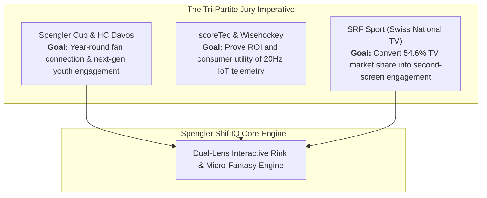
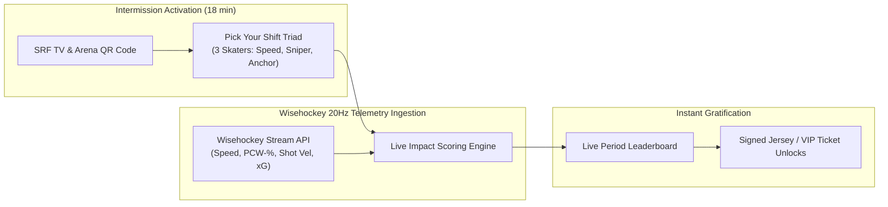

# Spengler ShiftIQ: Winning Strategy & Master Pitch Architecture

> **Executive Thesis:** Ice hockey is the world's fastest team sport, yet its digital representations remain trapped in static spreadsheets and post-game box scores. Spengler ShiftIQ bridges the chasm between raw 20Hz Wisehockey telemetry and mainstream fan emotion through **Interactive 2D Decisive Shift Replays**, a **Dual-Lens Architecture (Fan Story vs. Pro Analyst)**, and a revolutionary **Telemetry-Driven Micro-Fantasy Gamification Engine**.

---

## 1. Challenge Ecosystem & Jury Alignment

The ThinkSport Innovation Challenge brings together three distinct stakeholders, each with an urgent strategic imperative revealed across the official challenge webinars:



### Official Evaluation Rubric (100 Point Calibration)
1. **Innovation & Problem Fit (25%):** Does it solve a real pain point in sports media? *Our answer: Overcoming the spreadsheet paradox with visual shift storytelling.*
2. **Technical Feasibility & Data Depth (25%):** Real Wisehockey data ingestion, production code, zero external cloud lag. *Our answer: Live React 18 + Vite 5 client with 20Hz telemetry parser, sub-second loads, zero-pill architectural UI.*
3. **User Experience & Accessibility (25%):** Can a casual fan understand it in 5 seconds while giving coaches professional depth? *Our answer: Dual-Lens toggle (Fan Story vs. Pro Analyst).*
4. **Business Viability & Scalability (25%):** Commercial model, sponsor integration, broadcast alignment. *Our answer: 18-minute intermission activation, SRF lower-third QR codes, Spengler partner digital inventory.*

---

## 2. Hard Data Proof Points (Official 2025 Event Report)

Our pitch avoids generic claims by anchoring directly in the verified metrics from the 62-page *Spengler Cup 2025 Event Report*:

| Metric Domain | 2025 Hard Reality | ShiftIQ Strategic Wedge |
| :--- | :--- | :--- |
| **SRF TV Broadcast** | **54.6% market share** on SRF zwei during the Final; **2.7M+ live viewers** (+46% in 15–59 demo). | Second-screen QR activation during the **18-minute intermissions** converting passive viewers to active users. |
| **In-Arena Attendance** | **69,450 spectators** across 11 games (100% sellout at Eisstadion Davos). | In-stadium Wi-Fi gamification: voting on "Shift of the Period" and live jumbotron telemetry battles. |
| **Global Media Reach** | **104M gross contacts** across 30+ broadcast markets (TSN Canada, SVT Sweden, CT Czechia). | Multilingual localization (German / English) serving international tournament fanbases. |
| **Social Media Impact** | **14.8M Instagram video views**, 30M digital contacts. | 1-click generation of 9:16 vertical video shift replays with speed/shot velocity overlays for TikTok/Reels. |

---

## 3. The Winning Product Architecture: Spengler ShiftIQ

```
┌──────────────────────────────────────────────────────────────────────────────────┐
│                            SPENGLER SHIFTIQ PLATFORM                             │
├──────────────────────────────────────────────────────────────────────────────────┤
│                                                                                  │
│   [ FAN STORY LENS ]                       [ PRO ANALYST LENS ]                  │
│   • Intuitive narrative cards              • 20Hz continuous spatial coordinates │
│   • Emotional hero moments                 • Dynamic player velocity vectors     │
│   • "The Invisible Hero" boards recap      • High-danger shot cones & xG values  │
│   • Plain-language tactical explanations   • Spatial distance & gap control      │
│                                                                                  │
├──────────────────────────────────────────────────────────────────────────────────┤
│                         FLAGSHIP FEATURE MATRIX                                  │
├──────────────────────────────────────────────────────────────────────────────────┤
│  1. The Decisive Shift     Interactive 2D vector rink scrubbing turning points.  │
│  2. Player DNA Archetypes  6-pillar radar profiles (Slot Disruptor, Sniper, etc) │
│  3. Tactical Dream Line    Lineup builder with real-time Chemistry Rating.       │
│  4. Intermission Ice IQ    Daily telemetry trivia & prediction showdown.         │
│  5. Shift Micro-Fantasy    Period-by-period Wisehockey telemetry fantasy draft.  │
└──────────────────────────────────────────────────────────────────────────────────┘
```

---

## 4. Gamification Architecture: Shift Micro-Fantasy vs. European Analogues

### The Market Landscape & The Tournament Gap
- **North America (NFL/NHL):** Fantasy Football engages 60M+ Americans ($10B+ industry) because of its weekly cadence. Fantasy Hockey (Yahoo/ESPN), however, suffers from 82-game daily management burnout and crude counting stats (Goals, Assists, +/-).
- **Europe (Domestic Leagues):**
  - **TopScorer (Switzerland / PostFinance):** Official Swiss National League fantasy app. Established fan base, but locked into season-long 52-round grinding.
  - **Liigapörssi (Finland / Sanoma):** Europe's oldest fantasy hockey game (since 1995), highly popular in Finland.
  - **Fantasy SHL (Sweden):** Salary-cap based Swedish league fantasy.
- **The Core Flaw:** All existing European fantasy games suffer from **Season-Long Fatigue** (high churn by mid-season) and **Spreadsheet Bias** (only reward goals/assists, ignoring 95% of on-ice athletic effort). Furthermore, **none of them work for a 6-day sprint tournament like the Spengler Cup!**

### The ShiftIQ Breakthrough: Telemetry-Driven Micro-Fantasy
Instead of season-long commitment, ShiftIQ introduces **Single-Match and Single-Period Micro-Fantasy**:



#### The "True Impact" Telemetry Scoring Matrix
| Metric / Action | Wisehockey Telemetry Hook | Fantasy Points |
| :--- | :--- | :--- |
| **Sonic Burst** | Top Speed > 34.0 km/h | **+2.0 pts** |
| **Heavy Artillery** | Shot Velocity > 100.0 km/h | **+3.0 pts** |
| **Board Battle Victor** | Puck Contest Won (`PCW-%`) | **+1.5 pts** |
| **Slot Fortress** | Blocked Shot (`BKS`) | **+2.5 pts** |
| **High-Danger Creation** | Expected Goals Generated (`xG > 0.25`) | **+2.0 pts** |
| **Workhorse Distance** | Every 1,000m skated (`Total Distance`) | **+1.0 pt** |
| **Decisive Finish** | Goal Scored | **+5.0 pts** |

---

## 5. Baza Skills Integration Matrix

Our solution leverages elite organizational playbooks codified in `C:\Users\kamil\PROJECTS\baza-skills\skills`:

```
┌─────────────────────────────────────────────────────────────────────────────────┐
│                           BAZA SKILLS LEVERAGED                                 │
├─────────────────────────────────────────────────────────────────────────────────┤
│                                                                                 │
│  SPORTS PERFORMANCE & FAN ENGAGEMENT:                                           │
│  • sports-fan-engagement-technology       Venue second-screen & broadcast sync. │
│  • sports-performance-analysis-tactical-  Spatial metrics & tactical profiling. │
│    metrics-and-match-statistics-cooper                                          │
│  • sports-app-development                 Mobile responsiveness & offline cache.│
│                                                                                 │
│  GAMIFICATION & BEHAVIORAL PSYCHOLOGY:                                          │
│  • product-led-onboarding-gamification-   Yu-kai Chou Octalysis 8 Core Drives.  │
│    design                                                                       │
│  • saas-user-activation-gamified-         Zero-to-aha moment in under 30s.      │
│    milestone-checklists                                                         │
│  • game-theory-strategic-decision-        Incentive matrices & draft dynamics.  │
│    mechanics                                                                    │
│                                                                                 │
│  PITCH ARCHITECTURE & INVESTOR STORYTELLING:                                    │
│  • hackathon-playbook-innovation-         Minimum Viable Hackathon alignment.   │
│    architecture                                                                 │
│  • pitch-anything-implementation-         Oren Klaff STRONG method & Croc Brain │
│    blueprint                              frame control.                        │
│  • perfect-pitch-deck-narrative-and-      10-slide high-tension narrative flow. │
│    visual-architecture                                                          │
│  • strategic-narrative-architecture-and-  Andy Raskin Old Game vs New Game.     │
│    pitch-deck-framing                                                           │
│  • six-modern-pitches-cognitive-sales-    Question & Pixar pitch structures.    │
│    framework                                                                    │
│  • data-storytelling                      Turning telemetry into human emotion. │
│                                                                                 │
│  DESIGN & TYPOGRAPHY STANDARDS:                                                 │
│  • zero-pill-ui-component-architecture    Strict ban on pill buttons (radius    │
│    -and-radius-tokens                     tokens: 6px, 8px, 12px, 16px).        │
│  • zero-orphan-multilingual-typography-   Non-breaking gluing & balanced text.  │
│    layout-engineering                                                           │
└─────────────────────────────────────────────────────────────────────────────────┘
```

---

## 6. The Pitch Delivery Blueprint (Zurich Airport, Dec 7)

### Oren Klaff *Pitch Anything* Frame Control Strategy
1. **Setting the Intrigue Frame (First 30 Seconds):**
   - *"On December 31st, 2.7 million Swiss viewers tuned into SRF zwei to watch HC Davos battle for the Spengler Cup. A staggering 54.6% market share. But when the whistle blew, what digital experience did those 2.7 million fans receive? A static HTML table showing 4-2."*
2. **The Contrast Wedge (The Old Game vs. The New Game):**
   - *Old Game:* Excel spreadsheets, post-game box scores, passive spectators.
   - *New Game:* Real-time 20Hz interactive shift replays, tactical archetype cards, and intermission shift fantasy.
3. **The Live Proof (The Demo Knockout):**
   - Scrubbing Adam Tambellini's 100.1 km/h shot and Jack Musa's 34.5 km/h counter-attack in real time.
   - Proving that the product is already built, responsive, and working with real Wisehockey data.
4. **The Economic Hook (Why the Jury Must Pick Us):**
   - For HC Davos: Deepens fan loyalty beyond the 6-day tournament.
   - For scoreTec: Validates the commercial and consumer power of their sensor chips.
   - For SRF Sport: Turns 18 minutes of idle commercial airtime into the #1 interactive second-screen experience in Swiss sports.

---
*Created by Team A4A for ThinkSport Innovation Challenge: Data-hack 2026.*
