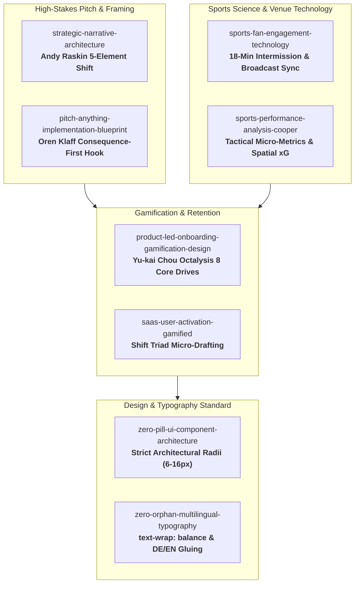

# Beyond Coach's Laptop: How Baza-Skills Shape Spengler ShiftIQ

> **The Core Economic Wedge:** HC Davos, scoreTec, and the Spengler Cup have already invested in deploying military-grade 20Hz sensor chips in every puck and player jersey. Today, 99.9% of that expensive telemetry remains trapped inside the locker room on the video coach and team manager's laptop.
> 
> **The Opportunity:** By democratizing this existing IoT infrastructure for the **2.7 million TV viewers on SRF zwei (54.6% market share)** and the **69,450 sellout spectators at Eisstadion Davos**, we turn an operational cost center into a massive fan engagement, sponsor activation, and revenue engine.
> 
> **This is Technology Utilization and Cost Optimization in Action.**

---

## 1. Skill Mapping & Architectural Blueprint



---

## 2. Deep Dive: Applying Each Skill to ShiftIQ

### Pillar A: Narrative & Pitch Framing

#### 1. `pitch-anything-implementation-blueprint` (Oren Klaff STRONG Method)
* **The 6-Second Consequence-First Hook:**
  Instead of opening with "Hello, we built a hockey app," open with the ROI reality:
  > *"Eisstadion Davos has one of the most advanced 20Hz sensor tracking networks in world sport. But right now, 99.9% of that data never leaves the coach's laptop. While coaches analyze micro-gaps, 2.7 million Swiss fans on SRF stare at a static 4-2 score. We are here to unlock that stranded asset."*
* **Moral Authority & Intrigue Duality:**
  * *Moral Authority:* An Olympic Silver Medalist systems architect leading independent technical builders with live working code.
  * *Intrigue:* What happens when fans draft fantasy lineups based on skating speed and board battles instead of just lucky goals?
* **Prizing Over Pricing:**
  Frame ShiftIQ not as an additional expense, but as the tool that *sweats existing hardware assets* and creates new digital sponsor inventory (UBS, Würth, scoreTec).

#### 2. `strategic-narrative-architecture-and-pitch-deck-framing` (Andy Raskin Framework)
* **The Undeniable Market Shift:** The death of single-screen viewing. 84% of sports fans now consume content on a second screen while watching live TV.
* **The Winners & Losers:**
  * *Losers:* Tournaments that keep telemetry locked on coaches' laptops, losing younger demographics to short-form entertainment.
  * *Winners:* Tournaments that turn fans into tactical co-pilots through interactive second-screen storytelling.
* **The Promised Land:** "Beyond Coach's Laptop"—transforming every fan into an informed insider who sees the invisible heroic work on the ice.
* **The Magic Powers:** Dual-Lens 2D Replay Scrubber, Player DNA Archetypes, and Telemetry Micro-Fantasy.
* **The Evidence:** Live code executing official Wisehockey tracking data from Davos 2025.

---

### Pillar B: Sports Science & Venue Technology

#### 3. `sports-fan-engagement-technology`
* **The 18-Minute Intermission Engine:**
  In hockey, the 18-minute intermission between periods is traditionally filled with TV commercials and resurfacing the ice. This skill dictates how we capture that dwell time:
  * Broadcast lower-third QR codes on SRF zwei during period wrap-ups.
  * Arena jumbotron prompts connected to Eisstadion Davos Wi-Fi.
  * Instant 10-second draft: fans pick their "Shift Triad" for the upcoming period.
* **Edge-Optimized Data Delivery:**
  Compressing Wisehockey coordinate arrays into ultra-compact JSON payloads (<50KB per shift sequence) to ensure zero buffering even on saturated arena cell towers.

#### 4. `sports-performance-analysis-tactical-metrics-and-match-statistics-cooper`
* **Translating Elite Coaching Metrics into Fan Stories:**
  * `PCW-%` (Puck Contests Won) $\rightarrow$ **"The Board Battle King"**
  * `Top Speed` $\rightarrow$ **"Breakout Velocity"** (e.g. Jack Musa's 34.5 km/h counter-attack)
  * `Shot Velocity` $\rightarrow$ **"Heavy Artillery"** (e.g. Adam Tambellini's 100.1 km/h laser)
  * `High-Danger xG` $\rightarrow$ **"Slot Threat Index"**
* **The Dual-Lens Philosophy:**
  * *Fan Story Lens:* Accessible, emotionally charged narratives explaining why a goal happened.
  * *Pro Analyst Lens:* Continuous 20Hz vector trails, micro-gap measurements, and spatial pressure cones.

---

### Pillar C: Gamification & Behavioral Retention

#### 5. `product-led-onboarding-gamification-design` (Yu-kai Chou Octalysis 8 Core Drives)
* **Core Drive 1 (Epic Meaning & Calling):** Fans represent their club faction (HC Davos supporters vs. Team Canada fans) in real-time telemetry duels.
* **Core Drive 2 (Development & Accomplishment):** "Ice IQ Rating" earned by making accurate tactical shift predictions, unlocking tiered badges (*Slot Whisperer*, *Speed Scout*).
* **Core Drive 3 (Empowerment of Creativity & Instant Feedback):** Building dynamic Shift Triads and watching telemetry points update every second during live play.
* **Core Drive 6 (Scarcity & Impatience):** The 10-minute countdown during intermission to lock in your Triad before the next period starts.
* **White-Hat Gamification Invariant:** Ensuring the experience empowers fans with genuine tactical appreciation rather than exploitative gambling mechanics.

#### 6. `saas-user-activation-gamified-milestone-checklists`
* **Zero-to-Aha in Under 30 Seconds:**
  1. Scan QR code $\rightarrow$ 2. Auto-load match center $\rightarrow$ 3. Tap 3 player cards (Speed, Sniper, Anchor) $\rightarrow$ 4. You're in the live competition. No mandatory 15-field registration forms.

---

### Pillar D: UI Architecture & Visual Integrity

#### 7. `zero-pill-ui-component-architecture-and-radius-tokens`
* **Strict Ban on Rounded-Full Pills:**
  * Small badges & metric chips: `rounded-md` (6px) or `rounded-lg` (8px).
  * Action buttons & tab toggles: `rounded-lg` (8px) or `rounded-xl` (12px).
  * Tactical cards & rink containers: `rounded-xl` (12px) or `rounded-2xl` (16px).
  * High-contrast dark-mode broadcast palette inspired by Swiss alpine precision.

#### 8. `zero-orphan-multilingual-typography-layout-engineering`
* **Bilingual Broadcast Standards:**
  * Automated non-breaking space gluing (`\u00A0`) on short German (*im, am, zu, für, von*) and English (*in, to, for, on*) connectives.
  * `text-wrap: balance` on all modal headings and `text-wrap: pretty` on tactical analysis cards to guarantee zero typographic orphans.

---

## 3. Measurable ROI for the Spengler Cup Ecosystem

```
┌───────────────────────┬───────────────────────────────────┬───────────────────────────────────┐
│ Stakeholder           │ Status Quo (Old Game)             │ ShiftIQ Powered (New Game)        │
├───────────────────────┼───────────────────────────────────┼───────────────────────────────────┤
│ **scoreTec /          │ Expensive IoT hardware confined   │ Scaled consumer product proving   │
│ Wisehockey**          │ to coaching video rooms.          │ multi-million spectator value.    │
├───────────────────────┼───────────────────────────────────┼───────────────────────────────────┤
│ **SRF Sport**         │ 18-min intermission viewer bounce │ #1 interactive second-screen      │
│                       │ during commercial breaks.         │ experience in Swiss sports.       │
├───────────────────────┼───────────────────────────────────┼───────────────────────────────────┤
│ **Spengler Cup /      │ 6-day attendance peak followed    │ Year-round digital fan academy    │
│ HC Davos**            │ by off-season engagement drop.    │ and youth fan acquisition.        │
├───────────────────────┼───────────────────────────────────┼───────────────────────────────────┤
│ **Tournament          │ Static arena billboard logos      │ Interactive branded telemetry     │
│ Sponsors (UBS/Würth)**│ with hard-to-measure ROI.         │ inventory (e.g. "Speed Award").   │
└───────────────────────┴───────────────────────────────────┴───────────────────────────────────┘
```

---
*Authored by Team A4A for ThinkSport Innovation Challenge: Data-hack 2026.*
